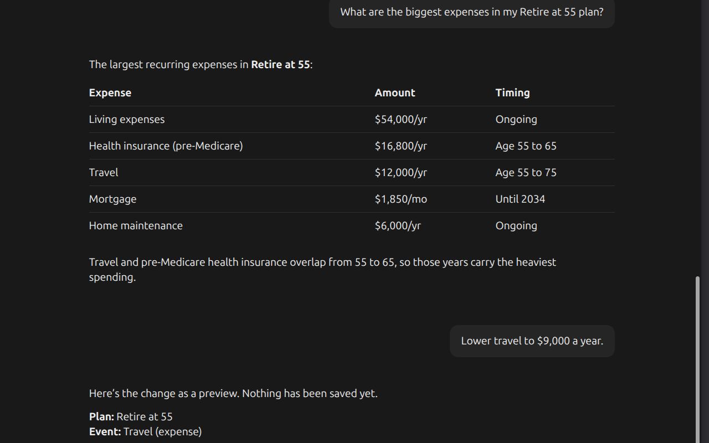

# ProjectionLab MCP Server

**Talk to an AI assistant about your retirement plan, and let it read and optionally update your numbers in [ProjectionLab](https://projectionlab.com) for you.**

ProjectionLab is a retirement and financial-planning app. This project connects it to an AI assistant that supports MCP servers, such as Claude Desktop or Claude Code, so you can ask questions in plain English about *your* actual plan. The assistant reads and edits your plan; ProjectionLab itself runs the projections, so you see the results (charts, Chance of Success) in the app.

- *"Walk me through what my plan assumes: returns, inflation, spending, and when Social Security starts."*
- *"Copy my plan as 'Returns -2%' and lower the stock and bond returns by 2 points in the copy, so I can compare the two in ProjectionLab."*
- *"Raise my travel spending to $12,000 a year."* (then check the effect in ProjectionLab)

*Asking about a plan, then previewing a change before it is saved.*

The assistant can look at your plan and walk through tradeoffs with you, and it changes things only when you say so. It starts read-only, previews each change before saving it, and backs up every change so it can be undone. Your API key stays on your computer.

---

## What you can use it for

Everything the assistant does, you could do by hand in ProjectionLab. What it adds is speed on tedious work and a second pair of eyes on your inputs.

- **Refresh your balances.** Paste figures from your statements, or let another tool your assistant is connected to supply them, and it updates the matching accounts in Current Finances.
- **Audit your plan.** It looks for stale balances, expenses that end too early or never end, inconsistent growth or inflation settings, and benefit start ages that look unintended.
- **Explain your plan.** It produces a readable report of a plan's settings, ordered by topic, or two plans side by side, and tells you exactly which values differ between plans or since a backup.
- **Build scenarios fast.** "Copy my plan and retire two years earlier," "lower returns by 2 points," "add a home purchase in 2030." It builds the copies; you compare the results in ProjectionLab.
- **Make bulk edits.** Raise every expense by a percentage, rename or tidy items, or apply the same change across several plans.
- **Think through tax strategy.** Talk through Roth conversions, tax brackets, and Medicare IRMAA thresholds against your own ages and income, then set up plan copies for ProjectionLab's Optimizer and projections to judge.
- **Undo and history.** See what changed and when, and roll any change back.

The assistant sees your plan's inputs, not its results: projections and Chance of Success run only in ProjectionLab. Its analysis is reasoning about your inputs, so check the effect of any change in the app.

---

## Get started

Paste this into your AI assistant:

> Please set up the ProjectionLab MCP server (the `projectionlab-mcp` npm
> package) for me. Follow the setup instructions at
> `https://github.com/Backroads4Me/projectionlab-mcp/blob/main/SETUP-FOR-AGENTS.md`.
> I'm not technical, so walk me through anything you need from me (like my
> ProjectionLab Plugin API key and installing the browser extension) one step at
> a time. Keep it in read-only mode until I say otherwise.

Your assistant installs the server, asks for your ProjectionLab Plugin API key, and walks you through a couple of short steps in your browser: adding a small helper extension from your browser's extension store and entering a connection code in its settings. When it's done, start asking questions about your plan.

If anything gets stuck, tell your assistant what you see on screen; it can troubleshoot from there.

Prefer to set it up yourself? See **[Manual setup](https://github.com/Backroads4Me/projectionlab-mcp/blob/main/MANUAL-SETUP.md)**.

---

## Safety

**What's at stake.** ProjectionLab holds only what you typed into it: account names, balances, income, expenses, ages, goals, and any notes you wrote. It has no bank logins, account numbers, or live connections to your financial institutions, so there is nothing here that can move money or open an account. The Plugin API key works only inside a browser tab where you are already signed in to your own ProjectionLab account; there is no ProjectionLab API that accepts the key on its own. The data that leaves your computer is your plan's figures, which go to the AI model your assistant uses, under that provider's privacy terms. The main risk to manage is an unwanted edit to your plan, which the protections below are built for.

- **Read-only by default.** The assistant can read your plan but not change it until you turn on **Enable agent plan edits** in the browser extension's options. Turning it off stops changes at once.
- **Preview before saving.** Every change is a preview until the assistant explicitly confirms it, and the assistant is instructed to show you the preview and ask first.
- **Undo.** Every confirmed change is backed up first, so it can be rolled back.
- **No overwriting your edits.** If a plan was saved in ProjectionLab after the assistant read it, the change is refused rather than overwriting your edit.
- **Stays on your computer.** Your API key and the connection token are stored only on your computer, and the browser connects only to the server running there.
- **Update-aware.** Your assistant mentions it once when a newer release is available; the server reads the latest release number from npm once per start (`PL_UPDATE_CHECK=false` turns that off).

Details are in the [safety model](https://github.com/Backroads4Me/projectionlab-mcp/blob/main/REFERENCE.md#safety-model) and [Privacy](https://github.com/Backroads4Me/projectionlab-mcp/blob/main/PRIVACY.md).

---

## More documentation

- **[Manual setup](https://github.com/Backroads4Me/projectionlab-mcp/blob/main/MANUAL-SETUP.md)**: set everything up yourself, step by step.
- **[Technical reference](https://github.com/Backroads4Me/projectionlab-mcp/blob/main/REFERENCE.md)**: host configuration, environment variables, tools, resources, prompts, the safety model, and building from source.
- **[How it works](https://github.com/Backroads4Me/projectionlab-mcp/blob/main/HOW-IT-WORKS.md)**: the architecture, wire protocol, extension internals, and security.
- **[Privacy](https://github.com/Backroads4Me/projectionlab-mcp/blob/main/PRIVACY.md)**: what the extension and server access and store.
- **[Setup for AI assistants](https://github.com/Backroads4Me/projectionlab-mcp/blob/main/SETUP-FOR-AGENTS.md)**: the install steps your assistant follows.
