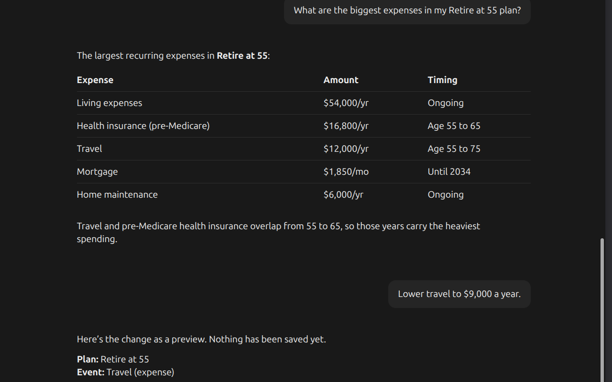

# ProjectionLab MCP Server

**Talk to an AI assistant about your retirement plan, and let it read and optionally update your numbers in [ProjectionLab](https://projectionlab.com) for you.**

ProjectionLab is a retirement and financial-planning app. This project connects it to an AI assistant that supports MCP servers, such as Claude Desktop or Claude Code, so you can ask questions in plain English about *your* actual plan. The assistant reads and edits your plan; ProjectionLab itself runs the projections, so you see the results (charts, Chance of Success) in the app.

- *"Walk me through what my plan assumes: returns, inflation, spending, and when Social Security starts."*
- *"Copy my plan as 'Returns -2%' and lower the stock and bond returns by 2 points in the copy, so I can compare the two in ProjectionLab."*
- *"Raise my travel spending to $12,000 a year."* (then check the effect in ProjectionLab)

*Asking about a plan, then previewing a change before it is saved.*

The assistant can look at your plan and walk through tradeoffs with you, and it changes things only when you say so. It starts read-only, previews each change before saving it, and backs up every change so it can be undone. Your API key stays on your computer.

---

## Get started

Paste this into your AI assistant:

> Please set up the ProjectionLab MCP server (the `projectionlab-mcp` npm
> package) for me. Follow the setup instructions at
> `https://github.com/Backroads4Me/projectionlab-mcp/blob/main/SETUP-FOR-AGENTS.md`.
> I'm not technical, so walk me through anything you need from me (like my
> ProjectionLab Plugin API key and loading the browser extension) one step at
> a time. Keep it in read-only mode until I say otherwise.

Your assistant installs the server, asks for your ProjectionLab Plugin API key, and walks you through a couple of short steps in your browser (loading a small helper extension and pasting in a code). When it's done, start asking questions about your plan.

If anything gets stuck, tell your assistant what you see on screen; it can troubleshoot from there.

Prefer to set it up yourself? See **[Manual setup](https://github.com/Backroads4Me/projectionlab-mcp/blob/main/MANUAL-SETUP.md)**.

---

## More documentation

- **[Manual setup](https://github.com/Backroads4Me/projectionlab-mcp/blob/main/MANUAL-SETUP.md)**: set everything up yourself, step by step.
- **[Technical reference](https://github.com/Backroads4Me/projectionlab-mcp/blob/main/REFERENCE.md)**: host configuration, environment variables, tools, resources, prompts, the safety model, and building from source.
- **[How it works](https://github.com/Backroads4Me/projectionlab-mcp/blob/main/HOW-IT-WORKS.md)**: the architecture, wire protocol, extension internals, and security.
- **[Privacy](https://github.com/Backroads4Me/projectionlab-mcp/blob/main/PRIVACY.md)**: what the extension and server access and store.
- **[Setup for AI assistants](https://github.com/Backroads4Me/projectionlab-mcp/blob/main/SETUP-FOR-AGENTS.md)**: the install steps your assistant follows.
